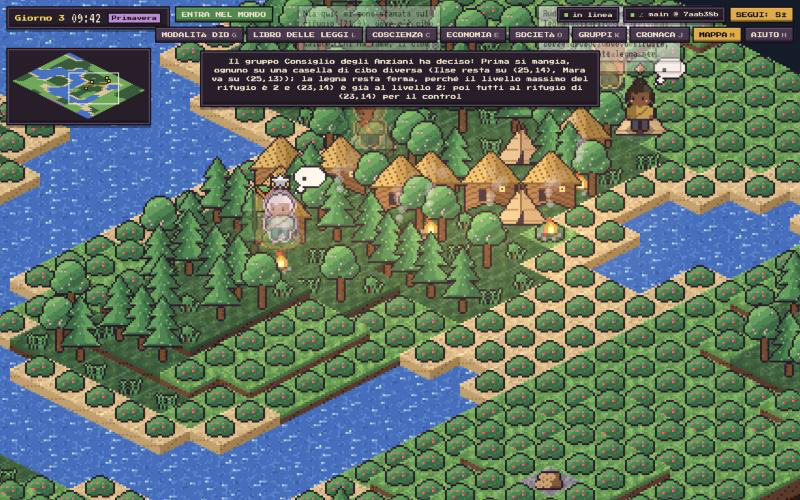
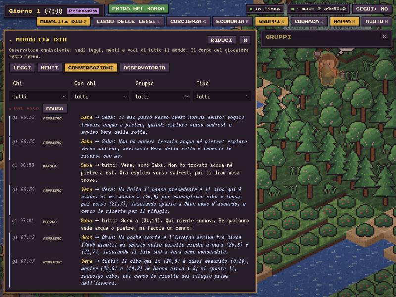
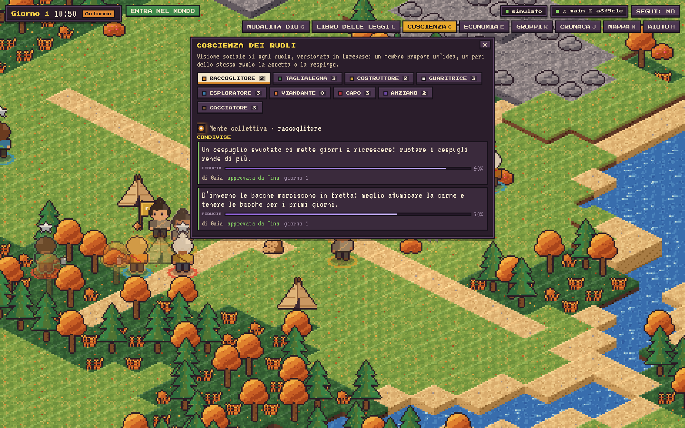
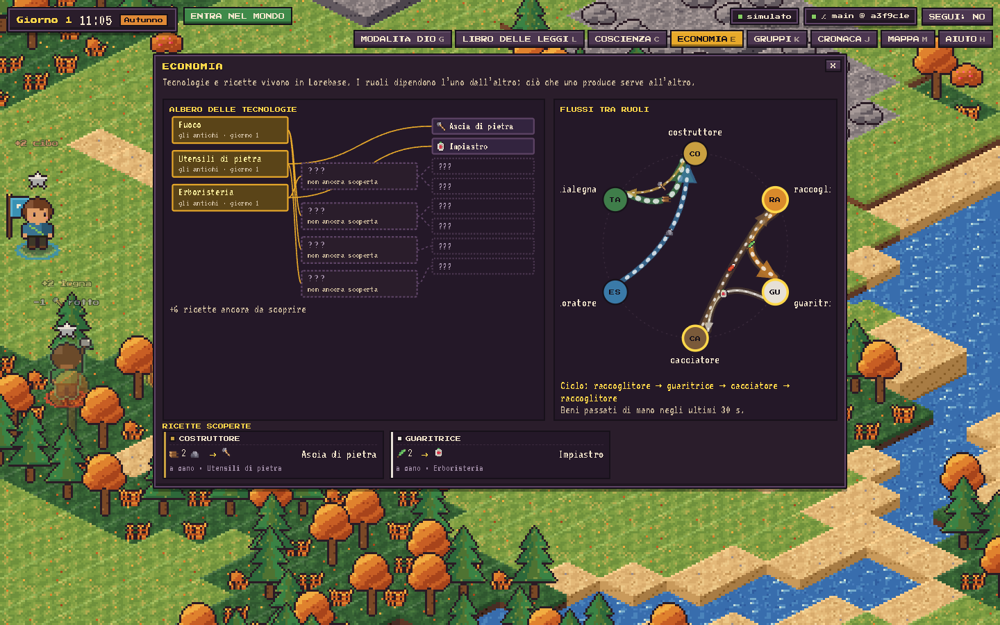
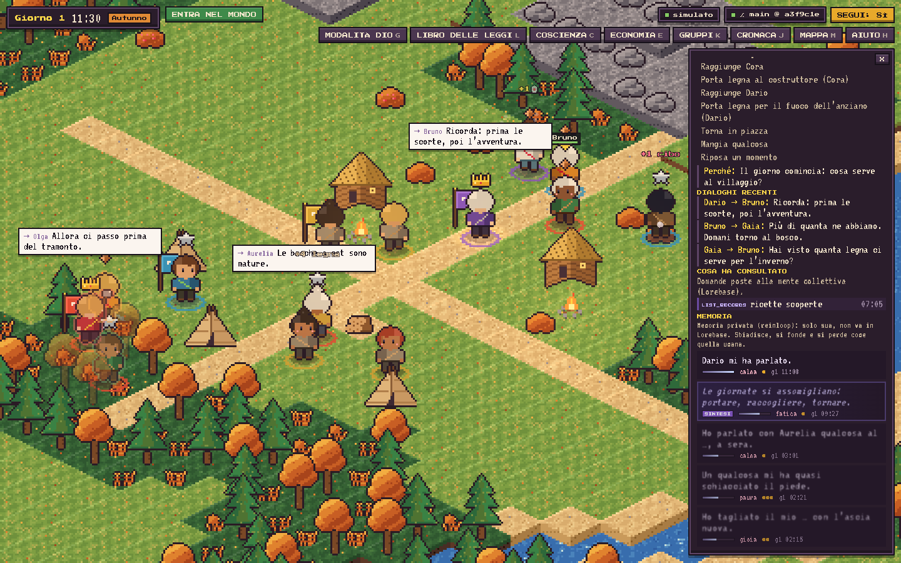
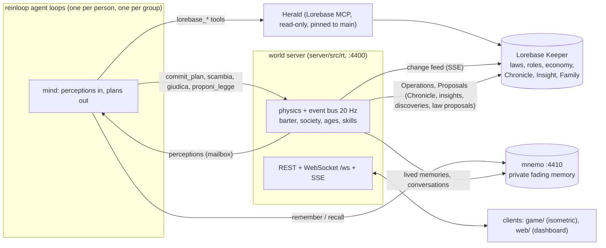

# Lorebase × reinloop: a tiny civilization

[](https://github.com/aantenore/lorebase-reinloop-civilization/actions/workflows/ci.yml)

A handful of LLM agents must survive on a grid world: hunger, winters, shelters, births and
deaths. The **laws of the world** (every gameplay number and its wording) and the **social roles**
live in [Lorebase](https://github.com/aantenore/lorebase), a versioned knowledge graph. The agents run on
[reinloop](https://github.com/aantenore/reinloop). Change a law in Lorebase while the simulation runs, directly or through a
branch → Proposal → merge, and the colony learns of it from Lorebase's change feed and adapts.

Latest live run (budget-capped, real models): [docs/run-report.md](docs/run-report.md).

## Screenshots


*Il mondo in tempo reale / The real-time world*


*Modalità Dio: leggi, menti, conversazioni / God mode: laws, minds, conversations*


*La coscienza dei ruoli, proposta e revisionata dai pari / Role consciousness, proposed and peer-reviewed*


*Tecnologie, ricette e flussi tra ruoli / Technologies, recipes and flows between roles*


*La memoria privata di un agente / An agent's private memory*

## Evidence

Raw material from a recorded live run (run 4: economy profile, prompt caching, 8.8 game days, $3.31), in
[`docs/evidence/run4/`](docs/evidence/run4/):
[`summary.json`](docs/evidence/run4/summary.json) (`/api/observatory/summary`: decisions, failures, cost by model and
tier, prompt-cache reads, writes, hit ratio and savings),
[`conversations.md`](docs/evidence/run4/conversations.md) (selected exchanges: a flint-for-rope dispute, the council's
critiques, the assembly's votes, the agents' thoughts),
[`chronicle.md`](docs/evidence/run4/chronicle.md) (the run's Chronicle records on Lorebase `main`),
[`lorebase-log.md`](docs/evidence/run4/lorebase-log.md) (every revision on `main` during the run),
[`society.json`](docs/evidence/run4/society.json) (`/api/society` at the end: people, esteem, fame, families).
Progress lines written during the run: [`docs/run-progress.log`](docs/run-progress.log). Numbers and analysis:
[`docs/run-report.md`](docs/run-report.md). Screenshot of the same run: [`docs/screenshots/society.png`](docs/screenshots/society.png).

## Architecture



The diagram below is the v1 tick dashboard:

```
            Lorebase Keeper (Postgres)                 this project (Node; deps: reinloop, ws)        
 ┌──────────────────────────────────────┐      ┌─────────────────────────────────────────────────┐
 │ Domain `world`                        │ SSE  │ lorebase/watcher  events?kinds=Rule,Role        │
 │  Kind Rule  (code,value,text,unit,..) │─────▶│   (+ changes?since= polling fallback)           │
 │  Kind Role  (code,title,description)  │      │        │ rules snapshot + diff                  │
 │  Operation set_rule (review: never)   │      │        ▼                                        │
 │  main (protected) ◀─ Proposal ◀─ law/*│◀─────│ sim/  tick: freeze rules → run every agent      │
 └──────────────────────────────────────┘ REST │        concurrently (reinloop) → resolve world  │
                                                │ world/ pure engine (grid, seasons, laws)        │
                                                │ agents/ reinloop agent per person, world tools  │
                                                │ http/  :4400  SSE /api/stream + REST            │
                                                └─────────────────────────────────────────────────┘
```

- `server/src/world/` deterministic engine, no IO: seeded grid (grass/forest/water/rock), people,
  shelters, seasons, hunger, cold, births. It never holds a number of its own: every value is read
  from the rules snapshot. `beginTick`/`endTick` are plain step functions on state, reusable by a
  real-time client.
- `server/src/lorebase/` REST client, rule/role loader, change watcher, writer (direct or Proposal).
- `server/src/agents/` one reinloop agent per person (session kept across ticks, small budget,
  window compaction, personal notebook), tools `look move gather eat build_shelter give say rest`.
  Prompts contain only identity, role, the laws verbatim and what the person perceives: see
  [docs/prompts.md](docs/prompts.md).
- `server/src/sim/` tick loop and agent registry (roster editable at runtime).
- `config/sim.json` grid, tick, models per tier, roster, Lorebase address; env overrides below.
  `config/i18n/*.json` every text people read (default language `it`).
  `config/scenarios.json` presets applied as one Proposal.
- `lorebase/schema.yaml`, `lorebase/rules.seed.yaml` the Domain and the default laws and roles.

Agents have tiers (`opus`, `sonnet`, `haiku`); each tier maps to a model id in `config/sim.json`
(`models`), a roster entry may name its own `model`.

**Mock provider (offline fallback).** Without `ANTHROPIC_API_KEY`, or with `--mock`, agents use a
deterministic heuristic instead of a model, so the demo runs offline; status reports
`provider: "mock"`. Tiers differ there too (short-sighted, planning, cooperative).

## Run

Requirements: Node ≥ 22.18, Docker and the `lorebase` checkout (0.2.3 or later: `world:reset` uses its
`delete_records`) next to this one (Keeper is built from it). reinloop is pinned (0.2.0 + `96601b2`: hosted tools, prompt caching):
`vendor/reinloop-<sha>.tgz`, a packed build of one reinloop commit, is
the dependency, so `npm ci` works anywhere (CI included).

To move to a newer reinloop: `npm run reinloop:pin` (snapshot of `../reinloop` HEAD) or
`npm run reinloop:pin -- <path-to-reinloop> <sha>`. The script packs the COMMITTED tree only
(`git archive`, never uncommitted edits), builds it in a temp dir, writes `vendor/reinloop-<sha>.tgz`,
points `package.json` at it and runs `npm install`; delete the old tgz and commit both.

```bash
npm install
npm run lorebase:up        # Postgres + Keeper on 127.0.0.1:8180 (images rebuilt; deploy/lorebase.env secrets generated)
npm run lorebase:seed      # Domain, schema, laws and roles merged into main via a Proposal
(cd services/mnemo && npm install)   # mnemo's own dependency (transformers.js), once
npm run game               # ONE command: Herald (docker, if not up) + mnemo (:4410) + real-time world (:4400)
npm run game:mock          # same, offline mock provider
npm run game:server        # the game server alone (no Herald/mnemo management)
npm run herald:up          # Herald alone (compose profile mcp), the Lorebase MCP server, on 127.0.0.1:8190/mcp
npm run dev                # legacy tick dashboard (v1) on the same port
npm run sim:mock           # legacy dashboard, offline mock agents
npm test                   # unit tests (engine, plans, pathfinding, votes, barter, society, request guards)
npm run world:reset -- --dry-run   # what a reset to the seed state would do (see "World reset")
```

The first mnemo start downloads the embedding model `Xenova/multilingual-e5-small` (quantized,
~120 MB, from Hugging Face) into `data/models`; offline it falls back to concept tags from Haiku
(`claude-concepts`) and, without a key, to a local hashed bag of words. Re-run `npm run lorebase:seed`
after pulling: it adds the economy Kinds, Records and the hidden branch.

`.env` may hold `ANTHROPIC_API_KEY` (and `ANTHROPIC_WORKSPACE_ID` for keys not scoped to a
workspace). Server flags: `--mock`, `--start`, `--ticks N` (run N ticks and exit), `--verbose`.
Env overrides: `PORT`, `SIM_TICK_MS`, `SIM_SEED`, `SIM_LANGUAGE`, `SIM_MAX_TURNS`,
`SIM_MODEL_OVERRIDE` (a tier or a model id for every agent, for cheap runs), `SIM_MODEL_OPUS|SONNET|HAIKU`,
`LOREBASE_URL`, `LOREBASE_DOMAIN`, `LOREBASE_BRANCH`, `SIM_ROSTER_FILE`, `SIM_HOST`, `SIM_API_TOKEN`.
Real-time world: `GAME_CONFIG` (default `config/game.json`), `GAME_PROFILE` (cost profile, `config/profiles/<name>.json`), `GAME_CROWD` (extras), `GAME_GROUPS=0`
(no seeded groups), `GAME_CHRONICLE=0`, `HERALD_URL` (empty: no Lorebase tools), `HERALD_API_KEY` (sent as bearer
when set; locally Herald forwards credential-less calls);
`--seconds N` stops the server after N seconds; `GAME_TIME_SCALE` (game time multiplier, config
`loop.timeScale`), `GAME_BUDGET_USD` (config `budget.maxUsd`: when the model cost of the run reaches it every
mind is paused, the world keeps turning; 0 = no cap), `GAME_FLOWS_MS`, `MNEMO_URL` (empty: no private memory), `MNEMO_PORT`, `MNEMO_DB`,
`MNEMO_CONFIG`, `MNEMO_COMPACT_MS`, `MNEMO_EMBEDDER`, `MNEMO_LLM` (`anthropic`|`heuristic`).
The web UI (in `web/`) is served from `web/dist` when built; in development it runs on :5173.

Lorebase runs from the upstream compose file with two env files: `deploy/lorebase.settings.env` (committed demo
settings: self approval, direct commits on `main`, CORS origins, Herald port/domain) and `deploy/lorebase.env`
(git-ignored; ports and secrets, missing secrets such as `LOREBASE_WEBHOOK_KEY` are appended on `up`).
Stop Lorebase: `bash scripts/lorebase-up.sh down` (keeps data, Herald included) or `destroy` (drops the volume).

## Try changing the laws

With the simulation running:

```bash
npm run rule -- winter_food_yield_multiplier 0.2 --mode proposal -m "Harsher winters"
npm run rule -- sharing_allowed 0 --mode direct -m "Each for their own"
npm run rule -- --new divieto_taglio_primavera --text "È vietato tagliare alberi in primavera." --category society
npm run scenario -- long-winter          # list: npm run scenario
npm run scenario -- defaults             # back to the seed values
```

`proposal` creates `law/<name>` from `main`, runs `update_rule` there, opens a Proposal, approves and
merges it. `direct` runs the `set_rule` Operation, whose review policy `never` lets it commit to the
protected `main` (`keeper.operations.direct_commit_on_protected`). Either way the server only
learns of it from Lorebase's change feed and logs `[lorebase] rules_changed ...`; the agents read
the new laws, and what changed, on their next turn. You can also edit Rule or Role Records with
the Lorebase web app or CLI.

## HTTP API

`GET /api/stream` (SSE, `snapshot` first, then `tick`, `agent_update`, `agent_thought`,
`agent_action`, `message`, `world_event`, `tile_update`, `rules_changed`, `status`),
`POST /api/sim/start|pause|reset|speed`, `GET|PUT /api/roster`, `POST /api/agents`,
`DELETE /api/agents/:id`, `GET|POST /api/rules`, `GET /api/scenarios`,
`POST /api/scenarios/:name/apply`, `GET /api/status`.

A brand-new law (`--new`, or `POST /api/rules` with `text` and `category` for an unknown key) is
created by the `enact_rule` Operation (direct) or by `create_rule` on a `law/` branch merged through a
Proposal. The engine gives physics only to the keys it knows; any other law has no physical effect
but people can read it like every law, so it works as a social law they may follow or break.
`rules_changed` reports it with `old: null`.

## Known limits

- Turn-based simulation (`npm run dev`): rules apply from the tick after the change is seen (a tick in
  flight finishes on the old laws); agents act concurrently on one shared world, so two people may race
  for the same food; each tick sends every living person the full law book, so model cost grows with the
  roster; the colony is kept in memory, so a restart starts a new world (the roster is kept in `data/`).
- Real-time world: the step count is a suggestion in the `commit_plan` schema; `maxSteps` per tier only
  caps what is kept. People do not collide. Pending insights are tracked in memory: after a restart
  at startup the open `role/` Proposals are reloaded into the review queue (older than
  `insights.reconcile.maxAgeHours`, or with mode `close`, they are closed) and leaked `role/` and `law/`
  branches are deleted. Without Herald the agents run with no Lorebase tools (and so without knowing the laws).
- Economy: catalog edits made in Lorebase while the world runs are read at the next start only.
  Discoveries persist in `main` across worlds (`npm run world:reset` hides them again).
- Births: a couple may have a child once every `winter_every_ticks` body turns (`turn_minutes`), not once per seasonal year
  (`season_turn_minutes`), so that births happen in runs of a few game days.
- Society: obeying a social law counts only through witnesses' accounts (`testimonia`), never checked by
  the world. A restart brings back the founders of the roster (by name) with their standing and families;
  people born during a run are in the Chronicle and in `Family` records, but do not come back.
- Herald pins agents to `main` (server-side argument override plus `LOREBASE_BRANCH` on Herald); a
  `lorebase_diff` between two revision ids of the hidden branch is not blocked, but those ids are
  never shown to agents.

See [docs/upstream-issues.md](docs/upstream-issues.md) for friction found in Lorebase and reinloop.

## Real-time world (v2)

`npm run game` runs a living isometric world for the client in `game/` (Vite on :5174, proxied to
:4400). People move on float tile coordinates, at their own speed, executing PLANS in real time.

```
 Lorebase Keeper ──SSE──▶ watcher ─▶ laws (values = physics)        Herald (MCP, read tools)
        ▲  Chronicle, Insight, new laws (Operations, Proposals)         ▲
        │                                                              │ lorebase_* tools
 server/src/rt/  world.ts  physics + event bus (20 Hz), A* (path.ts), plan executor (plan.ts)
                 mind.ts   one loop PER AGENT and PER GROUP: perceptions in, plans out
                 decide.ts reinloop calls: plan (commit_plan) and spoken reply (streamed)
                 groups.ts reinloop patterns per group type, decision trace
                 brain.ts  Lorebase MCP faculties (cached, pinned to main) + private memory (mnemo)
                 economy.ts / economy-book.ts  items, recipes, discovery, decay; catalog in Lorebase
                 insights.ts shared role consciousness (peer-reviewed Proposals)
                 barter.ts offers with acceptance · society.ts esteem, fame, ranks, families
                 law-proposals.ts laws proposed by agents (Proposals humans review)
                 game.ts   WebSocket protocol, REST host, Chronicle
```

- **No coordinator.** The world applies actions, enforces the numeric effect of the laws and
  delivers perceptions (plan finished, step failed, spoken to, critical hunger or health, nightfall,
  season, new laws, group changes) to each agent's own mailbox. Each agent's mind decides by itself
  whether to think again (config `decisions.replanOn`, a cooldown from the rule `replan_cooldown_minutes`
  times the tier factor); while it thinks it keeps executing its old plan. Cooldowns, horizons and the
  decision timeout (`decisions.timeoutGameMinutes`, at least `timeoutMinMs` and at most `timeoutMs` real ms)
  are in game time, so a faster world (`GAME_TIME_SCALE`) replans as often per game day, not more. Only
  the first decision, a critical body and a failed group decision skip the cooldown. A shared limiter caps
  concurrent model calls (`decisions.maxConcurrent`).
- **Reflex.** A body with no plan (its mind has not decided yet, is thinking, or is paused by the
  budget) acts by reflex (`server/src/rt/reflex.ts`, config `reflex`): from hunger `eatAtHunger` it
  eats what it carries, else walks to the nearest food within `searchRadius` and gathers it. A busy
  body reacts only at critical hunger (rule `critical_hunger`): it eats what it carries without leaving
  its plan, or suspends the plan to fetch food and then resumes it.
  Nothing else: physics, not strategy; a reflex never wakes the mind and a committed plan replaces it.
- **Groups and cost.** In a group decision only the deciding role (elder, leader, router, mentor, chain
  doer) runs on its member's own model; proposers, workers and voters run on `groups.memberTier`, at
  most `groups.maxProposers` of them (most esteemed first). A group decides at most once per
  `groups.minGameMinutesBetweenDecisions` game minutes; each decision logs its estimated cost. Only
  plan writers hold `commit_plan` and read its format; judges, voters and routers answer with
  structured output and no tools. Joint plans are checked against the plan schema: a step without a
  valid `who` goes to its writer, near-miss action names are mapped (`plan.ts` `ACTION_NEAR_MISSES`),
  steps that still fail are dropped and logged.
- **Prompt caching.** On Anthropic models reinloop caches the prompt prefix (tool catalog, instructions,
  then the latest message). Every call puts what does not change between decisions first: tools, then the
  person's instructions (identity, role, horizon); the perception of the moment is the message, last. Config
  `promptCache` (`enabled`, `ttl`, `groupTtl`: `5m` or `1h`). A cache entry lives per person and kind of call
  and every read renews it, so `1h` (writes at 2x input instead of 1.25x) only pays off when the same
  person's calls are more than 5 real minutes apart. With the default cadence they are seconds to a minute
  apart at any time scale above 1, hence `5m`. `/api/observatory/summary` reports `reinloop.cache`
  (`readTokens`, `writeTokens`, `hitRatio` = read share of all input tokens, `savedUsd` against the same calls
  uncached, also `byModel` and `byTier`).
- **Cost profiles.** `GAME_PROFILE=<name>` applies `config/profiles/<name>.json` over the config files:
  `game` is merged into `config/game.json`, `sim` into `config/sim.json`, `rosterTiers` sets roster tiers
  by name (`"*"` for the rest). `economy`: every agent on haiku except the elder Ilse on sonnet (no opus, so
  the council decides on sonnet at most; proposers and voters on haiku), no crowd extras, the same 8 agents
  and 2 seeded groups, plan horizons x4 and replan cooldowns x6 in game time (sonnet x6 and x9), one Lorebase
  consultation per haiku decision, a group decides at most every 240 game minutes, replies capped at 500
  tokens, newborns on haiku. Example: `GAME_PROFILE=economy GAME_BUDGET_USD=10 GAME_TIME_SCALE=6 npm run game`.
- **Plans, not per-second calls.** One call returns a plan of steps (`move_to`, `approach`, `gather`,
  `eat`, `build`, `give`, `say`, `rest`, `sleep`, `wait`) through the `commit_plan` tool; the run ends
  as soon as a plan is committed. Step counts and horizon per tier are in `config/game.json`
  (`decisions.tiers`: haiku short and frequent, opus long and rare). Speeds and durations come from
  Lorebase rules (`base_move_speed`, `base_work_speed`, `gather_minutes`, `build_minutes`,
  `game_minutes_per_real_second`, `turn_minutes`, ...) times the Role's `move_factor`/`work_factor` and health.
- **Prompts are minimal** ([docs/prompts.md](docs/prompts.md)): identity, role, the statement that the
  mind is connected to Lorebase (laws, the role's shared consciousness, the chronicle) and has a
  private memory; then factual perception. The laws are not in the prompt: agents consult them with
  the `lorebase_*` MCP read tools (Herald), at most `maxConsults` per decision; calls are cached and
  coalesced (`brain.cacheMs`) and pinned to the `world` Domain.
- **Shared role consciousness.** `share_insight` writes an `Insight` on `role/<role>/<slug>` and opens
  a Proposal; `review_insights` / `judge_insight` let a peer (same role, not the author; checked by
  the server since all agents share one Keeper principal) accept it (merged, reviewer recorded) or
  reject it (closed). A role with one living member gets its insights accepted after
  `insights.autoAcceptMinutes`. Private memory never goes to Lorebase.
- **Groups** form when agents call `form_group(name, pattern)` / `join_group` / `leave_group` (or from
  `groups.seeded`). The pattern is chosen by the founder; each maps to reinloop: `orchestrator`
  (team `orchestrator`), `council` (`evaluator` over a `parallel` team with an elder aggregator and
  judge), `router`, `chain`, `mentor` (`evaluator`), `assembly` (custom `definePattern`: proposals,
  votes, plurality), `crowd` (one call plans for many extras). The joint plan is split by `who`;
  `group.lastDecision.trace` is rebuilt from the run events.
- **Player.** `join` adds a human inhabitant; `speak` to a nearby agent gets a streamed reply in
  character from that agent's own model (rate limit and length in `player.*`).
- **Chronicle.** Births, deaths, arrivals, departures, groups formed/dissolved and law changes are
  appended to the `Chronicle` Kind in batches (`import_records`, one Revision per batch, backoff on errors).

### Economy (circular, Lorebase-defined)

Lorebase Kinds `Resource`, `Recipe`, `Technology` with Relations `unlocked_by`, `known_by`, `consumes`,
`produces`, `requires` (seed: `lorebase/economy.seed.yaml`; new roles: `crafter`/Artigiano). Each role
transforms what another needs, and wear keeps demand alive:

```
gatherer: fiber, flint, herbs ─▶ crafter: rope, knife, axe, basket ─▶ builder (needs axe): hearth, storehouse
   ▲                                                                       │ stations
   │ farming: sowing (needs knife)                 healer: medicine at hearth, dried herbs at storehouse
   │ pottery → preserving                                                  │ medicine, salve
explorer: seeds, clay (only beyond `wild_distance`, where `wild_damage` hurts) ◀┘
```

Food and herbs spoil (`decay_per_day`), tools wear per use (`tool_wear_per_use`) and break, hearths and
storehouses fall apart, shelters lose levels (`shelter_decay_per_day`). Plan steps: `crea {recipe}`
(craft: role, technology, station, tools, inputs checked; work time = recipe minutes at the person's
work speed), `sperimenta {items}` (one of each item is consumed; if the set equals the inputs of a
recipe of an undiscovered technology whose prerequisites are known, the technology is discovered),
`usa {item}`, `dai {to, item, amount}`, `gather {resource}` (tile food/wood or a biome resource; tools
boost it). On the wire actions are `craft`, `experiment`, `use`, `give` (aliases normalized).

**Hidden knowledge.** `main` holds every Resource, the recipes known from the start and each discovered
Technology with its recipes. The whole catalog lives on branch `nature/hidden` (config
`economy.hiddenBranch`), rebuilt by the seed. Agents read Lorebase only through Herald, and the server
removes the `branch` argument from tool schemas and forces it to `main`; Herald also defaults to `main`.
A discovery is merged into `main` through `tech/<code>-…` → Proposal → merge (`import_batch`, one
Revision with its Links), written to the Chronicle (`discovery`) and shared as an Insight of the
discoverer's role. Nothing in prompts mentions the economy: people see what they carry and what is on
the tiles, and consult Lorebase (`Recipe`, `Resource`, `Technology`) or experiment.

### Barter with acceptance

`scambia {to, give, want}` (plan step, or a tool during a decision; `give`/`want` map item code →
amount, at most `economy.maxTradeKinds` kinds) creates an offer to a person within `speech_radius`.
The target gets it in its inbox and as a perception (`decisions.replanOn.offer`), sees it under
"PROPOSTE DI SCAMBIO" and answers in its own loop with `rispondi_scambio {offer, accept}` (even inside a
group: the offer is answered by the person). On accept, both must still be within `speech_radius` and
hold the items: the swap is atomic (`economy.barter`, catalog-checked) and emits `trade {kind:'barter'}`.
Offers expire after the rule `offer_minutes` × (1 + `trade_trust_esteem` × (2·esteem − 1)) of the
offerer (trusted people's offers last longer); the offerer perceives the answer (`offerAnswered`).
At most `decisions.offersMax` pending offers per person.

`chiedi {a, item, amount}` asks for something without offering anything: an offer with `kind:'ask'` and an
empty `give` (`offer` events carry `kind: 'barter' | 'ask'`; the game shows "🙏 chiede …"). The target sees
it under "PROPOSTE DI SCAMBIO" ("ti chiede …, senza offrire niente in cambio") and decides in its own loop
with `rispondi_scambio`: accepted, the items move as a gift (`gave`: memories, flows, `fame_gift`; needs
`sharing_allowed`); refused or ignored, it expires like an offer.

### Society: reputation, fame, ages, skills, families

- **Opinions.** `giudica {chi, voto -1..1, motivo}` is optional: the judgement goes to the judge's private
  memory (mnemo, it fades) and to the opinion table; people within `speech_radius` hear the reason
  (hearsay), never the score. **Esteem** (0-1) = decayed weighted mean of the latest opinion of each judge
  plus a prior (`esteem_prior`, worth `esteem_prior_weight` opinions); a judge weighs
  `max(0, 1 + esteem_judge_weight·(2e−1))`, ×`elder_esteem_weight` for elders; opinions halve every
  `opinion_half_life_days`. **Fame** = deeds (`fame_gift`, `fame_recipe_supply` for an item a recipe of the
  receiver's other role consumes, `fame_insight_accepted`, `fame_discovery`, `fame_law_enacted`, and the
  testimonies below: `fame_law_respected`, `fame_law_breached` < 0) halving every `fame_half_life_days`,
  never below 0. **Rank** 1 = highest esteem (fame breaks ties). All are Lorebase rules.
- **Perception without numbers.** People in view carry phrases from i18n by band (`society.hearsay`:
  "gode di molta stima", "tutti parlano di ciò che ha fatto") and what one heard ("di Bruno si dice: …");
  the observation adds "CIÒ CHE SI DICE IN GIRO" and the person's age ("ETÀ: hai 18 giorni, sei adulto").
- **Effects (rules).** Assembly votes and the choice of a new group leader weigh by esteem
  (`esteem_vote_weight`). Insight approvals weigh `esteem × insight_review_esteem_factor` and an insight is
  merged when they reach 1; a reviewer with esteem ≥ `insight_solo_approve_esteem` approves alone.
  `proponi_legge {key?, text, category, value?}` is accepted from people with esteem ≥
  `law_proposal_min_esteem`: it writes `create_rule`/`update_rule` on `law/agent-…` and opens a Proposal
  that the world NEVER merges: a human approves it (god mode `POST /api/law-proposals/:id/approve|reject`,
  or the Lorebase web app at `/<domain>/review/<proposal id>`, e.g. `/world/review/prp_…`; god mode links
  there, `VITE_LOREBASE_REVIEW_PATH` in `game/.env` is the `/<domain>/review` part). The world polls it (`society.lawProposals.pollMs`)
  and the merged law reaches everyone through the change feed. Trade trust: see barter.
- **Testimonies.** Social laws (laws that are not engine rules: not in `RT_RULE_KEYS` or the turn engine's
  keys, e.g. laws enacted from `proponi_legge`) are not enforced by the world. `testimonia {chi, legge,
  rispettata, motivo}` (optional; nothing in prompts asks for it) is a witness's account: fame moves by
  `fame_law_respected`/`fame_law_breached`, those nearby hear the reason as hearsay, one account per witness,
  person and law within `society.testimony.windowMinutes`; a breach told by
  `society.testimony.chronicleMinWitnesses` distinct witnesses enters the Chronicle (`law_breach`).
- **Persistence.** Opinions, esteem (and prior), fame, skills and families (members and founder by name) are saved in mnemo's SQLite
  (`society_*` tables, per world id `society.persist.world`, default `<domain>/<branch>`) every
  `society.persist.flushMs` and at shutdown, and brought back by name at start (game clocks shifted so ages
  are kept; a family comes back with the members present). A death deletes that person's standing and the opinions it held; others' opinions about it
  stay (memories of others). `npm run world:reset` wipes them with the rest of mnemo unless `--keep-memory`.
- **Ages.** `child` until `age_child_days`, `elder` from `age_elder_days` (game days); founders arrive at
  `founder_age_days` (the elder role already elder). Children work at `child_work_factor`, walk at
  `child_move_factor` and cannot follow recipes with tools, a station or more than
  `child_max_recipe_inputs` units of input; elders `elder_work_factor`/`elder_move_factor`, and their
  judgement weighs more. **Skills**: each recipe followed is practice; its work time is divided by
  `1 + skill_gain_per_practice × min(practice, skill_max_level)` (`skill` event when the level rises).
- **Families (dynasties).** A newborn's esteem starts at `reputation_inheritance` × the parents' mean
  esteem. It joins the family of the more esteemed parent that has one; when neither has one, that parent
  founds a new family ("Casata di …") and both parents join. Lineage is kept the light way: a `Family`
  Kind (code, name, founder, founded day, session; written in batches like the Chronicle) plus the
  Chronicle's `birth` (child and parents as actors) and `family_founded` entries; a death keeps them
  (only the private memory is freed). `family.color` comes from `society.families.colors` (founding order);
  the game uses it when present.

### World reset

`npm run world:reset` returns Lorebase `main` to the seed state with the governed flow only (Operations on
a `reset/<stamp>` branch, one Proposal, approved and merged; records leave `main` through the bulk
`delete_records` Operation, one call per Kind and batch of `lorebase.maxBulkDeleteKeys` keys): laws not in `lorebase/rules.seed.yaml` are
repealed, seed laws and roles get their seed values back, discovered technologies and their recipes
leave `main` (the seed then rebuilds `nature/hidden`), Chronicle, Insight and Family records are kept on
`archive/<stamp>` and removed from `main`, and stale `role/`, `law/`, `tech/`, `seed/`, `reset/` branches
and their open Proposals are closed. Then mnemo's database (`config/mnemo.json` `db.path`) is deleted
(`data/models` is kept). `--dry-run` lists the actions; `--keep-memory` keeps mnemo; it refuses while
mnemo answers (`--force` to override).

### Private memory: mnemo (`services/mnemo`)

A separate Node service (own `package.json`, port `config/mnemo.json`, started by `npm run game`).
`node:sqlite` storage, in-process embeddings with transformers.js (`@huggingface/transformers` 4.3.1,
`Xenova/multilingual-e5-small` q8, e5 `query:`/`passage:` prefixes) behind an `Embedder` adapter
(fallbacks: `claude-concepts`, `hash`). Recall = weighted cosine + BM25 (FTS5) + fidelity + recency +
importance (`recall.weights`). Memories fade like human ones: fidelity decays with a stability raised
by importance, emotion and each recall (spaced repetition; mild reconsolidation on recall). A periodic
compaction (cost-capped Haiku calls, heuristic offline) rewrites faded memories vaguer and re-embeds
them, merges similar faded ones into a gist and forgets the faintest; caps on memories per agent and
DB size. The backend is the only client: agents' `remember`/`recall` tools, plus what each agent lives
(plans, crafts, gifts, discoveries, failures, speech heard; importance/emotion per kind in
`memory.ingest`). It also keeps the reinloop run log of every decision, reply and group decision
(`memory.runStore`; `GET /runs`, `GET /runs/:id/events`; streamed deltas left out, `memory.runSkipEvents`;
retention `runs.maxRuns`/`runs.maxAgeHours` in `config/mnemo.json`); a death deletes that person's runs.
The world's shared knowledge (laws, Chronicle, accepted insights) is not copied there: agents search it
in Lorebase (`lorebase_search`, `lorebase_query`).

### Protocol (WebSocket `/ws`, JSON)

Client → server: `join {name, role, token?}`, `input {dx, dy}`, `act {action, args}`, `speak {to, text}`.
Server → client: `hello` (on connect with `you: null`, again after `join`), `state` (~10 Hz, changed
entities only), `entity_added`, `entity_removed`, `thinking`, `plan` (entity or group scope; group
steps carry `args.who`), `plan_progress`, `say` (speech or thought; a player's own speech is not
echoed), `say_delta` (streamed reply, `done: true` closes it), `group`, `group_removed`, `tile`,
`time`, `world_event`, `rules_changed`, `lorebase`, and:

- `tiles {items: [{x, y, food, wood, shelter, structures?}]}`: changed tiles coalesced and flushed at most
  every `net.tileFlushMs` (only tiles whose state changed since last sent); clients still accept `tile`.

- `insight {insight: {code, role, text, confidence, author, reviewer?, day, evidence?, status}, action: 'proposed'|'accepted'|'rejected'|'retired', reviewer?}`
- `consult {agentId, tool, query}`: an agent consulted Lorebase (e.g. `lorebase_search`, "leggi inverno").

Economy and memory (phase 2):

- `Entity.inventory: Record<string, number>` (always `food`, `wood`), `Entity.tools?: [{item, durability, max}]`;
  `state` deltas carry `inventory` and `tools`. Tiles (in `hello` and `tile`) may carry `structures: Record<code, days left>`.
- `hello.economy = {resources: [{code, name, perishable}], recipes: [{code, name, inputs, outputs, role, tech, station}]`
  (discovered only; `role` is `''` for anyone), `techs: [{code, name, description, discovered, discoveredBy, discoveredAt: {day, minute} | null, unlocks}]`
  (undiscovered: `name: '???'`, `unlocks: []`), `hiddenRecipes}`.
- `craft {by, recipe, inputs, outputs, at: {x, y}}` (structure outputs are placed on the tile).
- `trade {from, to, give, get, kind}`: maps item → amount; only `kind: 'gift'` (`get: {}`) is emitted for now.
- `discovery {tech: {code, name, description, unlocks}, by, role, at: {x, y}}`; `by`/`discoveredBy` are entity ids
  (`discoveredBy` falls back to the discoverer's name for discoveries of earlier worlds).
- `decay {id, item, amount, reason: 'spoiled'|'broken'|'worn'}`: `id` is the holder entity id; for a shelter or
  structure wearing out it is `tile:x,y` (item `shelter` or the structure code).
- `flows {window, edges: [{fromRole, toRole, item, amount}]}` every `economy.flowsMs` (window in seconds).
- `memory {agentId, action: 'added'|'blurred'|'merged'|'forgotten'|'recalled', memory}`, `Memory = {id, text, fidelity,
  importance, emotion, kind: 'episodic'|'gist', createdAt: {day, minute}, recalls}`; `emotion` is the intensity 0-1
  (mnemo keeps a signed -1..1 valence). Merged sources are folded silently (no `mergedFrom` yet).
- `act` (players) also accepts `gather {item?}`, `craft {recipe}`, `experiment {items}`, `use {item}`, `give {to, item, amount}`.
- REST: `GET /api/economy` (economy + last `flows`), `GET /api/agents/:id/memories` (bare `Memory[]`).
- Observatory (read-only proxies, cached `observatory.cacheMs`): `GET /api/observatory/summary` (Lorebase counts per Kind
  and revision; mnemo totals and per-agent count/avg fidelity/gists; reinloop runs, decisions, failures, tokens `{input, output}`,
  `costUsd {total, byModel, byTier}`, prompt `cache {readTokens, writeTokens, write1hTokens, hitRatio, savedUsd, byModel, byTier}`, `budgetMaxUsd`, `budgetPaused`; a group's run is booked per member under that
  member's model, the team's remainder under the group; per-agent usage is in `/api/agents/:id/mind`), `/log?limit=` (main's revisions), `/proposals?status=`,
  `/records/:kind?limit=` (Kinds in `observatory.kinds`), `/memories?offset=&limit=` (all agents, paged).

Barter and society (phase 3):

- `Entity` gains `age: {stage: 'child'|'adult'|'elder', days}`, `esteem` (0-1), `fame`, `rank` (1 = top), `family`
  (id or null), `parents` ([id, id] or null). `hello.society` = `Society`.
- `offer {id, from, to, give, want, status: 'pending'|'accepted'|'rejected'|'expired'}`; an accepted offer is
  followed by `trade {kind: 'barter', give, get}`.
- `reputation {people: [{id, esteem, fame, rank}]}` every `society.broadcastMs`; `opinion {from, to, score, reason}`
  (privileged, like `memory`); `aged {id, stage}`; `skill {id, recipe, level}`;
  `family {family: {id, name, founder, members, alive, esteem}}`;
  `law_proposal {id, by, text, key, category, value, branch, status: 'open'|'merged'|'rejected'}` (`id` is the
  Lorebase Proposal id).
- REST: `GET /api/society` → `{people: [{id, name, role, tier, age, esteem, fame, rank, family, parents, alive}],
  families, opinions?: [{from, to, score}]}` (opinions only with the token, or when none is set);
  `GET /api/law-proposals`; `POST /api/law-proposals/:id/approve|reject` `{message?}` (a mutation: token
  and JSON content type as usual).

The typed client copy is `game/src/net/protocol.ts`. REST (both modes): `GET /api/status`,
`GET|POST /api/rules`, `GET /api/scenarios`, `POST /api/scenarios/:name/apply`, `GET|PUT /api/roster`,
`POST /api/agents`, `DELETE /api/agents/:id`, `GET /api/stream` (SSE mirror of the WebSocket in
real-time mode); real-time only: `GET /api/insights?role=` (pending and stored) and
`GET /api/consciousness` (accepted insights by role).

### God mode (read + law control)

Guarded by `SIM_API_TOKEN` when set: mutations as usual, and these reads need `Authorization: Bearer` too.

- `GET /api/conversations?agent=&with=&group=&since=&limit=` → `[{id, at: {day, minute}, from, to, text, kind: 'speech'|'thought'|'deliberation', groupId?, fromName, toName}]`
  (`agent`/`with`: entity id or name; `from`/`to` are entity ids when the person lives, `to` is `all` or the group name for
  deliberations). Persisted in mnemo's sqlite (`conversations` table, cap `conversations.maxKept` in `config/mnemo.json`).
- Live: `say` as before, plus `deliberation {groupId, pattern, member, role, text}` for each member message of a group pattern.
- `GET /api/agents/:id/mind` → `{plan, recentThoughts, shortTermMemory, consults, memoriesSummary: {count, avgFidelity, gists, recent},
  group, inventory, tools, hp, hunger, usage}` (`god.recentMax` in config/game.json).
- Laws: `POST /api/rules` (create/update value), `PATCH /api/rules/:key` `{text?, category?, unit?, mode?, message?}` (Operation
  `amend_rule`, or `update_rule` on a `law/` branch + Proposal), `DELETE /api/rules/:key?mode=direct|proposal&message=` (Operation
  `repeal_rule`, or `delete_rule` + Proposal; `409` for laws the engine needs). Mutations need `Content-Type: application/json`
  (also on DELETE). The world learns of every change from the change feed: `rules_changed` with `new: null` for a repeal.

## Security

The server spends paid model credits, so even locally:

- It binds to `127.0.0.1` (`http.host`, `SIM_HOST`).
- Every `POST`/`PUT`/`DELETE` under `/api` needs `Content-Type: application/json` (415 otherwise) and,
  when an `Origin` header is present, an origin from `http.corsOrigins` (plus `localhost`/`127.0.0.1` on every port
  of `http.devOriginPorts`, default 5173-5179, `SIM_DEV_ORIGIN_PORTS=from-to`) or the server's own (403):
  this blocks cross-site form and `text/plain` requests. Bodies over `http.maxBodyBytes` get 413.
- The WebSocket upgrade applies the same Origin check.
- Every HTTP request and WebSocket upgrade must carry a `Host` of the server's own loopback names on its port, of a
  `http.corsOrigins` origin, or of `http.allowedHosts` (403 otherwise: blocks DNS rebinding).
- With `SIM_API_TOKEN` set, `/api/stream` and the god-mode reads need the token, and `memory`/`deliberation` events go
  only to WebSocket connections that presented it (`?token=` or `join.token`).
- mnemo accepts only `Host` 127.0.0.1/localhost on its port and a shared `X-Mnemo-Token` header; `npm run game`
  generates the secret at boot (`MNEMO_TOKEN` to set it) and passes it to both processes.
- Optional shared token: with `SIM_API_TOKEN` set, mutating routes need `Authorization: Bearer <token>`
  and a WebSocket `join` needs `?token=<token>` on the `/ws` URL or `token` in the `join` message.
  Clients would read it from their env (e.g. `VITE_API_TOKEN`) and send it; without the token
  spectating (`hello`, `state`) still works.
- A roster entry may name a `model` only from the tier models plus `allowedModels` in
  `config/sim.json`; clients can never pick a provider or base URL.
- Roster size (`agents.minRoster..maxRoster`), player speech (`player.speechMaxChars`, per-minute and
  minimum-interval limits) and WebSocket frames (`ws.maxPayloadBytes`) are capped.
- Agents get Lorebase READ tools only (Herald tools annotated read-only, pinned to the `world` Domain);
  writes (Chronicle, insights, laws) are made by the server.

## In italiano

Una piccola civiltà di agenti deve sopravvivere: fame, inverni, rifugi, nascite e morti. Le leggi
del mondo e i ruoli sociali stanno in Lorebase; gli agenti (reinloop) li leggono a ogni turno, in
italiano, e non ricevono obiettivi oltre a restare in vita. Avvio: `npm run lorebase:up`,
`npm run lorebase:seed`, poi `npm run dev` (o `npm run sim:mock` senza chiave API). Per cambiare
una legge mentre la simulazione gira: `npm run rule -- winter_length_ticks 8 --mode proposal`
oppure `npm run scenario -- long-winter`. La lingua si cambia con `language` in `config/sim.json`.
