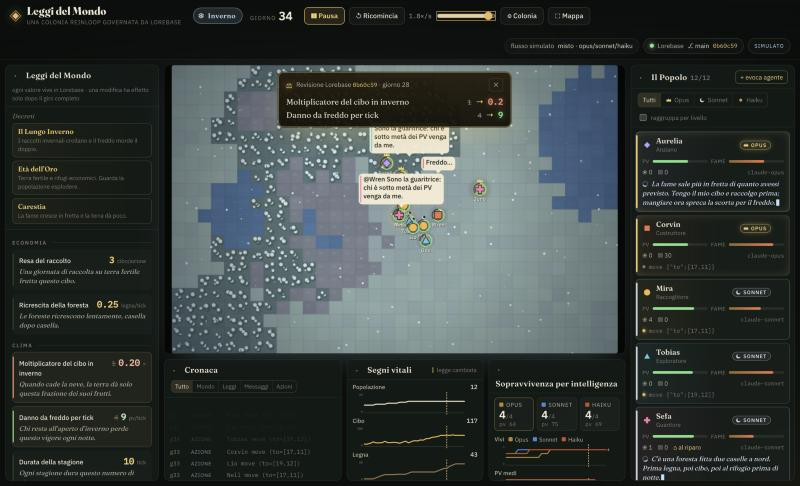
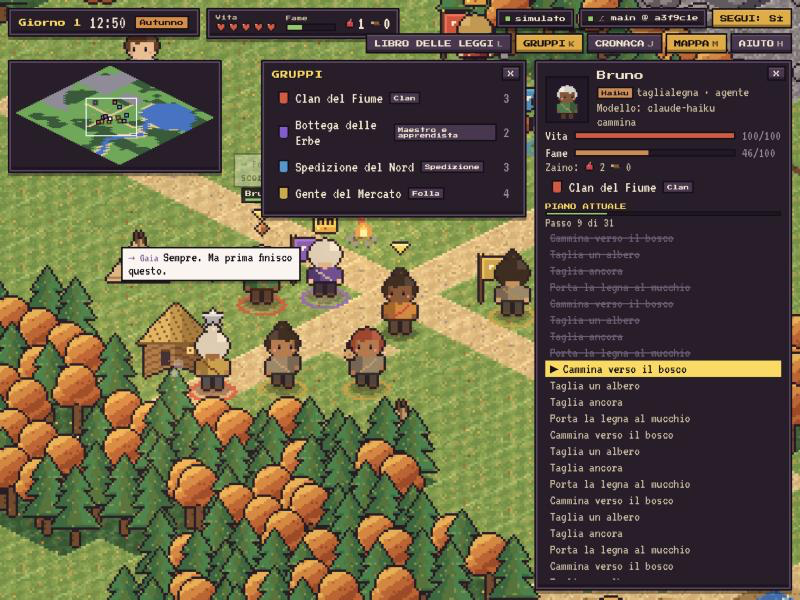
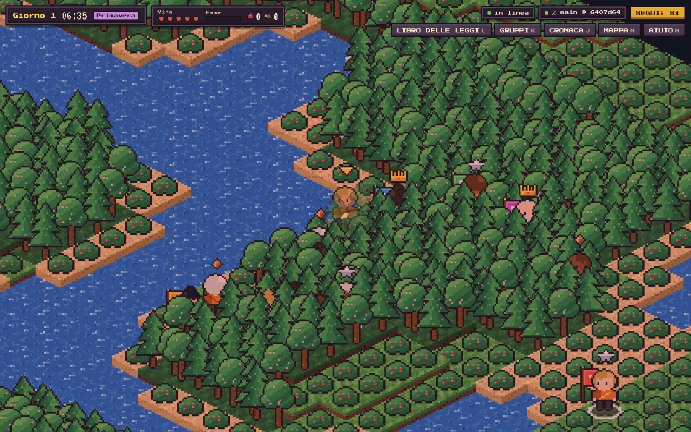

# Lorebase × reinloop: a tiny civilization

A handful of LLM agents must survive on a grid world: hunger, winters, shelters, births and
deaths. The **laws of the world** (every gameplay number and its wording) and the **social roles**
live in [Lorebase](../lorebase), a versioned knowledge graph. The agents run on
[reinloop](../reinloop). Change a law in Lorebase while the simulation runs, directly or through a
branch → Proposal → merge, and the colony learns of it from Lorebase's change feed and adapts.

## Screenshots


*Dashboard: leggi e stato del mondo / laws and world state.*


*Gioco in modalita' offline (mock) / game running offline (mock provider).*


*Gioco in tempo reale con agenti LLM / real-time game with LLM agents.*

## Architecture

```
            Lorebase Keeper (Postgres)                 this project (Node; deps: reinloop, ws)        
 ┌──────────────────────────────────────┐      ┌─────────────────────────────────────────────────┐
 │ Domain `world`                        │ SSE  │ lorebase/watcher  events?kinds=Rule,Role        │
 │  Kind Rule  (code,value,text,unit,..) │─────▶│   (+ changes?since= polling fallback)           │
 │  Kind Role  (code,title,description)  │      │        │ rules snapshot + diff                  │
 │  Operation set_rule (review: never)   │      │        ▼                                        │
 │  main (protected) ◀─ Proposal ◀─ law/*│◀─────│ sim/  tick: freeze rules → run every agent      │
 └──────────────────────────────────────┘ REST │        concurrently (reinloop) → resolve world  │
                                                │ world/ pure engine (grid, seasons, laws)        │
                                                │ agents/ reinloop agent per person, world tools  │
                                                │ http/  :4400  SSE /api/stream + REST            │
                                                └─────────────────────────────────────────────────┘
```

- `server/src/world/` deterministic engine, no IO: seeded grid (grass/forest/water/rock), people,
  shelters, seasons, hunger, cold, births. It never holds a number of its own: every value is read
  from the rules snapshot. `beginTick`/`endTick` are plain step functions on state, reusable by a
  real-time client.
- `server/src/lorebase/` REST client, rule/role loader, change watcher, writer (direct or Proposal).
- `server/src/agents/` one reinloop agent per person (session kept across ticks, small budget,
  window compaction, personal notebook), tools `look move gather eat build_shelter give say rest`.
  Prompts contain only identity, role, the laws verbatim and what the person perceives: see
  [docs/prompts.md](docs/prompts.md).
- `server/src/sim/` tick loop and agent registry (roster editable at runtime).
- `config/sim.json` grid, tick, models per tier, roster, Lorebase address; env overrides below.
  `config/i18n/*.json` every text people read (default language `it`).
  `config/scenarios.json` presets applied as one Proposal.
- `lorebase/schema.yaml`, `lorebase/rules.seed.yaml` the Domain and the default laws and roles.

Agents have tiers (`opus`, `sonnet`, `haiku`); each tier maps to a model id in `config/sim.json`
(`models`), a roster entry may name its own `model`.

**Mock provider (offline fallback).** Without `ANTHROPIC_API_KEY`, or with `--mock`, agents use a
deterministic heuristic instead of a model, so the demo runs offline; status reports
`provider: "mock"`. Tiers differ there too (short-sighted, planning, cooperative).

## Run

Requirements: Node ≥ 22.18, Docker, the `lorebase` and `reinloop` checkouts next to this one
(reinloop built once: `cd ../reinloop && npm install && npm run build`).

```bash
npm install
npm run lorebase:up        # Postgres + Keeper on 127.0.0.1:8180 (deploy/lorebase.env generated)
npm run lorebase:seed      # Domain, schema, laws and roles merged into main via a Proposal
npm run herald:up          # Herald, the Lorebase MCP server, on 127.0.0.1:8190/mcp (real-time world)
npm run game               # real-time world (v2): WebSocket /ws + REST on 127.0.0.1:4400
npm run game:mock          # same, offline mock provider
npm run dev                # legacy tick dashboard (v1) on the same port
npm run sim:mock           # legacy dashboard, offline mock agents
npm test                   # unit tests (engine, plans, pathfinding, votes, request guards)
```

`.env` may hold `ANTHROPIC_API_KEY` (and `ANTHROPIC_WORKSPACE_ID` for keys not scoped to a
workspace). Server flags: `--mock`, `--start`, `--ticks N` (run N ticks and exit), `--verbose`.
Env overrides: `PORT`, `SIM_TICK_MS`, `SIM_SEED`, `SIM_LANGUAGE`, `SIM_MAX_TURNS`,
`SIM_MODEL_OVERRIDE` (a tier or a model id for every agent, for cheap runs), `SIM_MODEL_OPUS|SONNET|HAIKU`,
`LOREBASE_URL`, `LOREBASE_DOMAIN`, `LOREBASE_BRANCH`, `SIM_ROSTER_FILE`, `SIM_HOST`, `SIM_API_TOKEN`.
Real-time world: `GAME_CONFIG` (default `config/game.json`), `GAME_CROWD` (extras), `GAME_GROUPS=0`
(no seeded groups), `GAME_CHRONICLE=0`, `HERALD_URL` (empty: no Lorebase tools), `HERALD_API_KEY`;
`--seconds N` stops the server after N seconds.
The web UI (in `web/`) is served from `web/dist` when built; in development it runs on :5173.

Stop Lorebase: `bash scripts/lorebase-up.sh down` (keeps data) or `destroy` (drops the volume).

## Try changing the laws

With the simulation running:

```bash
npm run rule -- winter_food_yield_multiplier 0.2 --mode proposal -m "Harsher winters"
npm run rule -- sharing_allowed 0 --mode direct -m "Each for their own"
npm run rule -- --new divieto_taglio_primavera --text "È vietato tagliare alberi in primavera." --category society
npm run scenario -- long-winter          # list: npm run scenario
npm run scenario -- defaults             # back to the seed values
```

`proposal` creates `law/<name>` from `main`, runs `update_rule` there, opens a Proposal, approves and
merges it. `direct` runs the `set_rule` Operation, whose review policy `never` lets it commit to the
protected `main` (`keeper.operations.direct_commit_on_protected`). Either way the server only
learns of it from Lorebase's change feed and logs `[lorebase] rules_changed ...`; the agents read
the new laws, and what changed, on their next turn. You can also edit Rule or Role Records with
the Lorebase web app or CLI.

## HTTP API

`GET /api/stream` (SSE, `snapshot` first, then `tick`, `agent_update`, `agent_thought`,
`agent_action`, `message`, `world_event`, `tile_update`, `rules_changed`, `status`),
`POST /api/sim/start|pause|reset|speed`, `GET|PUT /api/roster`, `POST /api/agents`,
`DELETE /api/agents/:id`, `GET|POST /api/rules`, `GET /api/scenarios`,
`POST /api/scenarios/:name/apply`, `GET /api/status`.

A brand-new law (`--new`, or `POST /api/rules` with `text` and `category` for an unknown key) is
created by the `enact_rule` Operation (direct) or by `create_rule` on a `law/` branch merged through a
Proposal. The engine gives physics only to the keys it knows; any other law has no physical effect
but people can read it like every law, so it works as a social law they may follow or break.
`rules_changed` reports it with `old: null`.

## Known limits

- Rules apply from the tick after the change is seen; a tick in flight finishes on the old laws.
- Agents act concurrently on one shared world: two people may race for the same food.
- Model cost grows with the roster: each tick sends every living person the full law book.
- The colony is kept in memory; a server restart starts a new world (the roster is kept in `data/`).
- Real-time world: step counts per tier are asked for, not enforced (models often write fewer steps;
  the person decides again when the plan ends). People do not collide. Pending insights are tracked
  in memory: after a restart their `role/` branches and open Proposals stay in Lorebase unjudged.
  Without Herald the agents run with no Lorebase tools (and so without knowing the laws).

See [docs/upstream-issues.md](docs/upstream-issues.md) for friction found in Lorebase and reinloop.

## Real-time world (v2)

`npm run game` runs a living isometric world for the client in `game/` (Vite on :5174, proxied to
:4400). People move on float tile coordinates, at their own speed, executing PLANS in real time.

```
 Lorebase Keeper ──SSE──▶ watcher ─▶ laws (values = physics)        Herald (MCP, read tools)
        ▲  Chronicle, Insight, new laws (Operations, Proposals)         ▲
        │                                                              │ lorebase_* tools
 server/src/rt/  world.ts  physics + event bus (20 Hz), A* (path.ts), plan executor (plan.ts)
                 mind.ts   one loop PER AGENT and PER GROUP: perceptions in, plans out
                 decide.ts reinloop calls: plan (commit_plan) and spoken reply (streamed)
                 groups.ts reinloop patterns per group type, decision trace
                 brain.ts  Lorebase MCP faculties (cached) + private memory (fileNotes, data/minds)
                 insights.ts shared role consciousness (peer-reviewed Proposals)
                 game.ts   WebSocket protocol, REST host, Chronicle
```

- **No coordinator.** The world applies actions, enforces the numeric effect of the laws and
  delivers perceptions (plan finished, step failed, spoken to, critical hunger or health, nightfall,
  season, new laws, group changes) to each agent's own mailbox. Each agent's mind decides by itself
  whether to think again (config `decisions.replanOn`, a cooldown from the rule `replan_cooldown_minutes`
  times the tier factor); while it thinks it keeps executing its old plan. A shared limiter caps
  concurrent model calls (`decisions.maxConcurrent`).
- **Plans, not per-second calls.** One call returns a plan of steps (`move_to`, `approach`, `gather`,
  `eat`, `build`, `give`, `say`, `rest`, `sleep`, `wait`) through the `commit_plan` tool; the run ends
  as soon as a plan is committed. Step counts and horizon per tier are in `config/game.json`
  (`decisions.tiers`: haiku short and frequent, opus long and rare). Speeds and durations come from
  Lorebase rules (`base_move_speed`, `base_work_speed`, `gather_minutes`, `build_minutes`,
  `game_minutes_per_real_second`, `turn_minutes`, ...) times the Role's `move_factor`/`work_factor` and health.
- **Prompts are minimal** ([docs/prompts.md](docs/prompts.md)): identity, role, the statement that the
  mind is connected to Lorebase (laws, the role's shared consciousness, the chronicle) and has a
  private memory; then factual perception. The laws are not in the prompt: agents consult them with
  the `lorebase_*` MCP read tools (Herald), at most `maxConsults` per decision; calls are cached and
  coalesced (`brain.cacheMs`) and pinned to the `world` Domain.
- **Shared role consciousness.** `share_insight` writes an `Insight` on `role/<role>/<slug>` and opens
  a Proposal; `review_insights` / `judge_insight` let a peer (same role, not the author; checked by
  the server since all agents share one Keeper principal) accept it (merged, reviewer recorded) or
  reject it (closed). A role with one living member gets its insights accepted after
  `insights.autoAcceptMinutes`. Private memory never goes to Lorebase.
- **Groups** form when agents call `form_group(name, pattern)` / `join_group` / `leave_group` (or from
  `groups.seeded`). The pattern is chosen by the founder; each maps to reinloop: `orchestrator`
  (team `orchestrator`), `council` (`evaluator` over a `parallel` team with an elder aggregator and
  judge), `router`, `chain`, `mentor` (`evaluator`), `assembly` (custom `definePattern`: proposals,
  votes, plurality), `crowd` (one call plans for many extras). The joint plan is split by `who`;
  `group.lastDecision.trace` is rebuilt from the run events.
- **Player.** `join` adds a human inhabitant; `speak` to a nearby agent gets a streamed reply in
  character from that agent's own model (rate limit and length in `player.*`).
- **Chronicle.** Births, deaths, arrivals, departures, groups formed/dissolved and law changes are
  appended to the `Chronicle` Kind in batches (`import_records`, one Revision per batch, backoff on errors).

### Protocol (WebSocket `/ws`, JSON)

Client → server: `join {name, role, token?}`, `input {dx, dy}`, `act {action, args}`, `speak {to, text}`.
Server → client: `hello` (on connect with `you: null`, again after `join`), `state` (~10 Hz, changed
entities only), `entity_added`, `entity_removed`, `thinking`, `plan` (entity or group scope; group
steps carry `args.who`), `plan_progress`, `say` (speech or thought; a player's own speech is not
echoed), `say_delta` (streamed reply, `done: true` closes it), `group`, `group_removed`, `tile`,
`time`, `world_event`, `rules_changed`, `lorebase`, and:

- `insight {insight: {code, role, text, confidence, author, reviewer?, day, evidence?, status}, action: 'proposed'|'accepted'|'rejected'|'retired', reviewer?}`
- `consult {agentId, tool, query}`: an agent consulted Lorebase (e.g. `lorebase_search`, "leggi inverno").

The typed client copy is `game/src/net/protocol.ts`. REST (both modes): `GET /api/status`,
`GET|POST /api/rules`, `GET /api/scenarios`, `POST /api/scenarios/:name/apply`, `GET|PUT /api/roster`,
`POST /api/agents`, `DELETE /api/agents/:id`, `GET /api/stream` (SSE mirror of the WebSocket in
real-time mode); real-time only: `GET /api/insights?role=` (pending and stored) and
`GET /api/consciousness` (accepted insights by role).

## Security

The server spends paid model credits, so even locally:

- It binds to `127.0.0.1` (`http.host`, `SIM_HOST`).
- Every `POST`/`PUT`/`DELETE` under `/api` needs `Content-Type: application/json` (415 otherwise) and,
  when an `Origin` header is present, an origin from `http.corsOrigins` or the server's own (403):
  this blocks cross-site form and `text/plain` requests. Bodies over `http.maxBodyBytes` get 413.
- The WebSocket upgrade applies the same Origin check.
- Optional shared token: with `SIM_API_TOKEN` set, mutating routes need `Authorization: Bearer <token>`
  and a WebSocket `join` needs `?token=<token>` on the `/ws` URL or `token` in the `join` message.
  Clients would read it from their env (e.g. `VITE_API_TOKEN`) and send it; without the token
  spectating (`hello`, `state`) still works.
- A roster entry may name a `model` only from the tier models plus `allowedModels` in
  `config/sim.json`; clients can never pick a provider or base URL.
- Roster size (`agents.minRoster..maxRoster`), player speech (`player.speechMaxChars`, per-minute and
  minimum-interval limits) and WebSocket frames (`ws.maxPayloadBytes`) are capped.
- Agents get Lorebase READ tools only (Herald tools annotated read-only, pinned to the `world` Domain);
  writes (Chronicle, insights, laws) are made by the server.

## In italiano

Una piccola civiltà di agenti deve sopravvivere: fame, inverni, rifugi, nascite e morti. Le leggi
del mondo e i ruoli sociali stanno in Lorebase; gli agenti (reinloop) li leggono a ogni turno, in
italiano, e non ricevono obiettivi oltre a restare in vita. Avvio: `npm run lorebase:up`,
`npm run lorebase:seed`, poi `npm run dev` (o `npm run sim:mock` senza chiave API). Per cambiare
una legge mentre la simulazione gira: `npm run rule -- winter_length_ticks 8 --mode proposal`
oppure `npm run scenario -- long-winter`. La lingua si cambia con `language` in `config/sim.json`.
